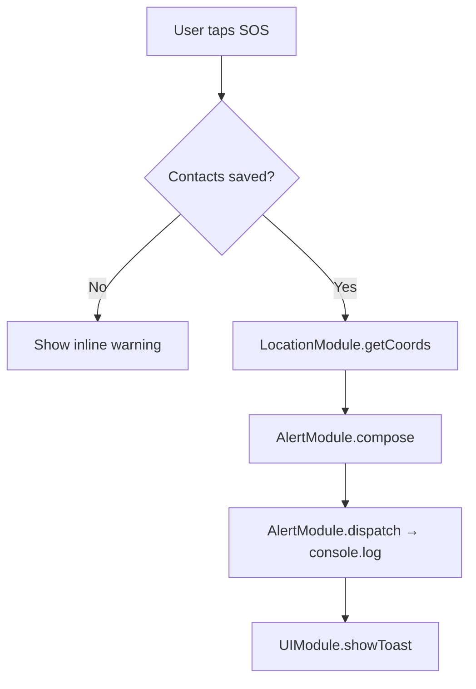
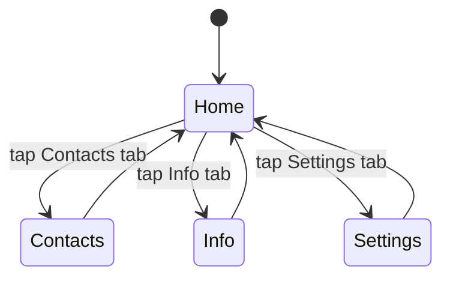

# Design Document: Women Safety Alert

## Overview

The Women Safety Alert app is a single-file mobile web application (HTML + CSS + JavaScript) with zero dependencies, no build step, and no backend. All state is persisted in `localStorage`. The app is structured as a tabbed single-page application with four views: Home, Contacts, Info, and Settings.

The core flow is:
1. User opens the app → location permission is requested
2. User adds trusted contacts via the Contacts tab
3. User configures their name and optional custom message in Settings
4. In an emergency, user taps (or holds) the SOS button → alert is composed and "sent" (logged + displayed)

Because there is no real SMS gateway, "sending" is simulated: the composed message is logged to the browser console and shown in a confirmation toast. The design is intentionally simple and resilient — it must work offline, on low-end devices, and under stress.

---

## Architecture

The app is a single `index.html` file. JavaScript is organized into logical modules using the **Revealing Module Pattern** (plain IIFE-based modules, no ES module syntax, for maximum browser compatibility without a bundler).

```
index.html
├── <style>          — All CSS (mobile-first, CSS custom properties for theming)
└── <script>
    ├── StorageModule     — Read/write localStorage
    ├── LocationModule    — Geolocation API + 30s refresh
    ├── ContactModule     — CRUD for trusted contacts
    ├── AlertModule       — Compose + dispatch alerts
    ├── UIModule          — DOM helpers, toast, tab switching
    └── AppInit           — Bootstrap: wire events, load state, start location
```

### Data Flow



### Tab Navigation



---

## Components and Interfaces

### StorageModule

Wraps `localStorage` with typed helpers. All keys are namespaced under `wsa_`.

```
StorageModule.getContacts()         → Contact[]
StorageModule.saveContacts(list)    → void
StorageModule.getSettings()         → Settings
StorageModule.saveSettings(obj)     → void
StorageModule.clearAll()            → void
```

### LocationModule

```
LocationModule.init()               → void   (starts watch + 30s refresh)
LocationModule.getCoords()          → { lat, lng, simulated: bool }
LocationModule.isSimulated()        → bool
```

- On init, calls `navigator.geolocation.watchPosition`.
- If denied/unavailable, falls back to a hardcoded simulated coordinate and sets `simulated = true`.
- A `setInterval` every 30 seconds calls `getCurrentPosition` to refresh.

### ContactModule

```
ContactModule.getAll()              → Contact[]
ContactModule.add(name, phone)      → { ok: bool, error?: string }
ContactModule.remove(id)            → void
ContactModule.validate(name, phone) → { ok: bool, errors: string[] }
```

Validation rules (from Requirement 3.2–3.3):
- `name`: non-empty after trim
- `phone`: non-empty, matches `/^[0-9 +\-]{7,15}$/` (digit count 7–15)

### AlertModule

```
AlertModule.compose(contacts, coords, settings) → string[]
AlertModule.dispatch(contacts, coords, settings) → { sent: number }
```

`compose` returns one message string per contact (personalized with contact name if desired, but the message body is the same). `dispatch` calls `console.log` for each and returns the count.

Message format (Requirement 4.1, 4.4):
```
[Name] needs help! [custom message or "I am in danger and need immediate assistance."]
Time: [ISO timestamp]
Location: https://maps.google.com/?q=[lat],[lng]
```

Total length target: ≤ 320 chars excluding the location link.

### UIModule

```
UIModule.showTab(tabName)           → void
UIModule.showToast(message, ms)     → void
UIModule.showWarning(el, message)   → void
UIModule.clearWarning(el)           → void
UIModule.renderContacts(list)       → void
```

`showTab` adds/removes the `active` class on tab panels and nav buttons. `showToast` creates a fixed-position element, appends it, then removes it after `ms` milliseconds (default 3000).

### AppInit

The bootstrap function that runs on `DOMContentLoaded`:
1. Load settings and contacts from `StorageModule`
2. Populate Settings form fields
3. Render contact list
4. Start `LocationModule.init()`
5. Wire all event listeners (SOS button click, hold timer, form submits, tab clicks, settings save, clear data)

---

## Data Models

### Contact

```js
{
  id: string,        // crypto.randomUUID() or Date.now().toString()
  name: string,      // trimmed, non-empty
  phone: string      // validated phone string
}
```

Stored as a JSON array under `localStorage["wsa_contacts"]`.

### Settings

```js
{
  userName: string,         // used in alert composition, default ""
  customMessage: string,    // max 100 chars, default ""
  holdToAlertEnabled: bool  // default true
}
```

Stored as a JSON object under `localStorage["wsa_settings"]`.

### AppState (in-memory only)

```js
{
  coords: { lat: number, lng: number, simulated: bool },
  activeTab: "home" | "contacts" | "info" | "settings",
  holdTimer: TimeoutID | null
}
```

Not persisted — reconstructed on each page load.

---

## Correctness Properties

*A property is a characteristic or behavior that should hold true across all valid executions of a system — essentially, a formal statement about what the system should do. Properties serve as the bridge between human-readable specifications and machine-verifiable correctness guarantees.*


### Property 1: Alert dispatched to all contacts

*For any* non-empty list of trusted contacts, when the SOS button is activated (by click or by 3-second hold), the alert dispatch count returned by `AlertModule.dispatch` should equal the number of contacts in the list.

**Validates: Requirements 1.2, 1.3**

---

### Property 2: Alert message contains all required fields

*For any* settings object (with a non-empty `userName`) and any valid coordinates, the message string produced by `AlertModule.compose` should contain the sender's name, a distress statement, a timestamp, and a Google Maps URL constructed from the provided coordinates, and the message body (excluding the location link) should be under 320 characters.

**Validates: Requirements 4.1, 4.4, 2.3**

---

### Property 3: Custom message replaces default distress statement

*For any* settings object where `customMessage` is non-empty, the message produced by `AlertModule.compose` should contain the custom message text and should not contain the default distress statement.

**Validates: Requirements 4.2**

---

### Property 4: Contact validation rejects invalid inputs

*For any* contact submission where the name is empty (or whitespace-only) or the phone number is empty, contains invalid characters, or has fewer than 7 or more than 15 digits, `ContactModule.validate` should return `{ ok: false }` with a non-empty `errors` array identifying the invalid field(s).

**Validates: Requirements 3.2, 3.3, 3.4**

---

### Property 5: Contact persistence round-trip

*For any* list of valid contacts saved via `StorageModule.saveContacts`, calling `StorageModule.getContacts` should return a list with the same contacts (same id, name, phone) in the same order.

**Validates: Requirements 3.7**

---

### Property 6: Contact deletion removes from list

*For any* contact list containing at least one contact, deleting a contact by its id should result in a list that no longer contains that contact's id, and the list length should decrease by exactly one.

**Validates: Requirements 3.6**

---

### Property 7: Settings persistence round-trip

*For any* settings object saved via `StorageModule.saveSettings`, calling `StorageModule.getSettings` should return an equivalent object with the same `userName`, `customMessage`, and `holdToAlertEnabled` values.

**Validates: Requirements 7.4**

---

### Property 8: Custom message length enforcement

*For any* string of more than 100 characters, the settings save logic should either reject it or truncate it to 100 characters before persisting.

**Validates: Requirements 7.3**

---

### Property 9: Tab switching shows only active tab

*For any* tab name in `["home", "contacts", "info", "settings"]`, after calling `UIModule.showTab(tabName)`, only the panel corresponding to that tab should have the `active` class; all other panels should not.

**Validates: Requirements 8.5**

---

### Property 10: Toast displays correct contact count and auto-dismisses

*For any* dispatch result with N contacts notified, the toast message should contain the text "Alert sent to N contact(s)", the toast element should be present in the DOM immediately after dispatch, and it should be removed from the DOM after 3000ms.

**Validates: Requirements 1.4, 9.1, 9.2**

---

### Property 11: Contact list renders all saved contacts

*For any* list of contacts passed to `UIModule.renderContacts`, the resulting DOM should contain one list item per contact, each showing the contact's name and phone number.

**Validates: Requirements 3.5**

---

## Error Handling

| Scenario | Behavior |
|---|---|
| Geolocation denied | Fall back to simulated coords `{ lat: 0, lng: 0, simulated: true }`; show persistent banner "Location unavailable — using simulated location" |
| SOS with no contacts | Show inline warning on home screen: "Please add at least one trusted contact first." No alert dispatched. |
| Contact form invalid | Show field-level error messages inline; do not save contact; keep form populated |
| localStorage unavailable | Catch `SecurityError`; show one-time warning "Storage unavailable — data will not be saved across sessions"; continue in-memory |
| Custom message > 100 chars | Truncate to 100 chars on save; show inline note "Message truncated to 100 characters" |
| `crypto.randomUUID` unavailable | Fall back to `Date.now().toString() + Math.random()` for contact IDs |

---

## Testing Strategy

### Dual Testing Approach

Both unit tests and property-based tests are required. They are complementary:
- Unit tests catch concrete bugs with specific inputs and verify integration points
- Property-based tests verify universal correctness across the full input space

### Unit Tests (specific examples and edge cases)

- SOS button is present and visible on initial load (Req 1.1)
- SOS with empty contact list shows warning, no dispatch (Req 1.5)
- Geolocation denial triggers simulated location indicator (Req 2.4)
- Contacts tab click shows contact manager (Req 5.1, 5.2)
- Info tab shows ≥ 5 tips and ≥ 3 emergency numbers (Req 6.2, 6.3)
- Settings tab shows hold-to-alert toggle (Req 7.5)
- Bottom nav bar contains all four tabs (Req 8.2)
- SOS button dimensions ≥ 120×120px (Req 8.3)
- Toast position does not overlap SOS button bounding box (Req 9.3)
- 10 contacts render without layout overflow (Req 5.3)

### Property-Based Tests

Use **fast-check** (browser-compatible UMD build loaded via CDN) for property-based testing. Each test runs a minimum of **100 iterations**.

Each test must be tagged with a comment in the format:
`// Feature: women-safety-alert, Property N: <property_text>`

| Property | Test Description |
|---|---|
| Property 1 | Generate random contact lists (1–20 contacts); verify dispatch count equals list length for both click and hold activation |
| Property 2 | Generate random `userName` strings and coordinate pairs; verify composed message contains name, timestamp, maps URL, and body ≤ 320 chars |
| Property 3 | Generate random non-empty `customMessage` strings; verify composed message uses custom text, not default |
| Property 4 | Generate random invalid name/phone combinations; verify `validate` returns `ok: false` with non-empty errors |
| Property 5 | Generate random valid contact arrays; save then load; verify round-trip equality |
| Property 6 | Generate random contact lists with ≥ 1 contact; delete random contact; verify removal and length decrease |
| Property 7 | Generate random settings objects; save then load; verify round-trip equality |
| Property 8 | Generate strings of length > 100; verify save truncates or rejects |
| Property 9 | For each of the 4 tab names; call `showTab`; verify only that panel has `active` class |
| Property 10 | Generate random contact counts (1–20); dispatch; verify toast text and DOM lifecycle with timer mocks |
| Property 11 | Generate random contact arrays (0–15 contacts); render; verify DOM item count and content |

### Test File

Tests live in a single `tests.html` file (no build step) that loads `fast-check` from CDN and imports the app's module functions. Tests run in the browser console or a headless browser (e.g., Playwright).
